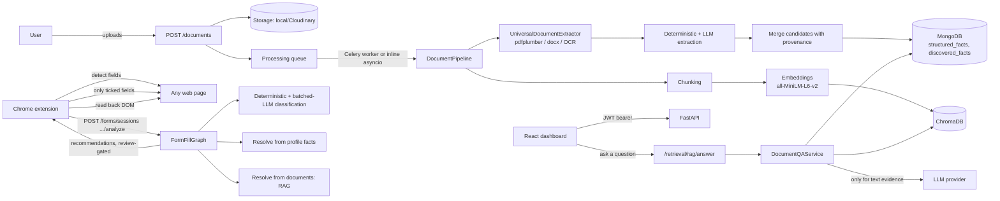

# Smart Form Auto-Filling System

A privacy-first assistant that reads a user's own documents (Aadhaar/PAN-style identity records, marksheets, certificates, bank passbooks, bills…), turns them into verified profile facts, and fills web forms from those facts — only after the user reviews and explicitly approves every value. It never auto-submits a form.

> Legend used throughout this document and the [Judge Demonstration Guide](docs/JUDGE_DEMONSTRATION_GUIDE.md):
> ✅ **Implemented and verified** (read from source, exercised by a passing test, or run locally during this review) · 🟡 **Implemented, not independently re-verified in this pass** · ⚠️ **Partially implemented / known gap** · ⛔ **Planned, not implemented**

## 1. Problem statement

People retype the same identity, academic and financial details into dozens of unrelated web forms (admissions, scholarships, government services, account opening), copying values by hand from PDFs, scans and photos of certificates. This is slow, error-prone (date-of-birth vs. issue date, Class 10 vs. Class 12 percentage, account number vs. IFSC), and gives no record of *where* a filled value came from.

## 2. Project overview

The system has three cooperating parts, all implemented in this repository:

1. A **FastAPI backend** that accepts document uploads, runs OCR/parsing and extraction, stores verified facts in MongoDB, indexes document text in ChromaDB for retrieval, answers natural-language questions over the user's own documents (Ask Documents), and runs a LangGraph pipeline that classifies a web form's fields and recommends values.
2. A **React dashboard** where the user manages documents, resolves conflicting values, asks questions, and reviews pending field decisions.
3. A **Chrome extension (Manifest V3)** that reads the fields of whatever page the user opens it on, asks the backend for recommendations, shows them for review, and — only for ticked fields — writes the value into the page and re-reads the DOM to confirm it stuck.

Document understanding and retrieval use a hybrid of deterministic rules (regex/label matching, validated identifier checksums, table parsing) and an optional LLM track; the LLM is only ever asked to fill gaps the deterministic pass left, and its output is schema-validated before use. See §14 for the exact RAG pipeline and §16 for the extension.

## 3. Objectives (implemented)

- ✅ Accept PDF/DOCX/TXT/image uploads and extract structured facts (identity, academic, financial, certificate concepts) with page-level evidence.
- ✅ Run OCR for scanned/photographed documents (RapidOCR, optional install) with preprocessing (deskew, contrast, orientation).
- ✅ Store every extracted value with its source document, page, confidence and origin (`extracted`/`normalized`/`inferred`), and let the user confirm, edit or reject it.
- ✅ Detect and let the user resolve conflicts when two documents disagree.
- ✅ Answer natural-language questions over a user's own documents with cited sources, computed answers for subject aggregates and age thresholds, and a clearly-marked fictional eligibility-rules demo (§9).
- ✅ Detect form fields in an arbitrary web page, map them to the same ontology concepts used for facts, and recommend values with a confidence-gated review flow.
- ✅ Fill only user-approved fields, verify the filled value against the live DOM, and never submit the form.
- ⚠️ Multi-provider LLM support (Google/OpenAI/Anthropic/Ollama/mock) with an optional fallback provider — implemented; only the `mock` and `google` paths were exercised in this review (§17).

## 4. Key features

| Feature | Status | Where |
|---|---|---|
| Document upload (PDF, DOCX, TXT, PNG/JPG) | ✅ | `backend/app/api/v1/documents.py`, `frontend/src/pages/Documents.tsx` |
| OCR + layout-aware extraction (tables, scanned pages) | ✅ | `backend/app/processing/extractor.py`, `ocr.py` |
| Deterministic + LLM document extraction, merged with provenance | ✅ | `backend/app/extraction/service.py`, `deterministic.py`, `document_extractor.py`, `llm_extraction.py`, `merge.py` |
| Structured fact storage, profile view, conflict resolution | ✅ | `backend/app/services/facts.py`, `frontend/src/pages/Profile.tsx`, `Conflicts.tsx` |
| Vector indexing + retrieval (ChromaDB) | ✅ | `backend/app/db/chroma_client.py`, `app/services/retrieval.py` |
| Ask Documents (RAG + structured facts + derived calculations + sources) | ✅ | `backend/app/services/document_qa.py`, `frontend/src/pages/Ask.tsx` |
| Fictional entrance-exam readiness/eligibility reasoning | ✅ (clearly labelled fictional rules) | `backend/app/exams/service.py`, `requirements.yaml`, `demo_requirements.yaml` |
| Semantic form-field classification (deterministic + batched LLM) | ✅ | `backend/app/agents/field_classifier.py`, `app/agents/graph.py` |
| Chrome extension: detect, review, fill, verify | ✅ | `extension/src/content/detector.ts`, `autofill.ts`, `popup/AutofillFlow.tsx` |
| Never-fill-password/payment/OTP + prompt-injection quarantine | ✅ | `backend/app/agents/graph.py` (`_sanitize`), `app/security/prompt_safety.py` |
| Judge demonstration dataset (15 synthetic docs/forms) + automated evaluation | ✅ | `demo/`, `docs/RUN_GUIDE.md`, `docs/JUDGE_DEMONSTRATION_GUIDE.md` |
| Unused `RAGAnswerService` (plain RAG answer without structured facts/derivations) | ⚠️ instantiated in `main.py` but **no route calls it** — dead code; the live `/retrieval/rag/answer` route uses `DocumentQAService` instead | `backend/app/services/retrieval.py` vs `app/api/v1/retrieval.py` |

## 5. System architecture



Data flow in words: a document goes **upload → storage → OCR/parse → deterministic + LLM extraction → MongoDB (facts) and ChromaDB (chunks)**. A form-fill request goes **detect fields (extension) → classify (deterministic, then batched LLM for the rest) → resolve value (profile facts, then document retrieval) → confidence-gated recommendation → user review → fill → read-back verification**. An Ask Documents question goes **plan the question → pull matching structured facts and/or retrieved chunks → compute any derived values (percentages, ages) deterministically → one LLM call to compose the prose answer from the cited evidence, or list the evidence directly if the LLM is unavailable**.

## 6. Technology stack

| Technology | Purpose | Where |
|---|---|---|
| Python 3.11, FastAPI | Backend API, routing, validation | `backend/app/main.py`, `backend/app/api/v1/` |
| MongoDB (via Motor) | Source of truth: users, documents, facts, sessions | `backend/app/db/mongo*.py`, `app/repositories/` |
| ChromaDB (HTTP v2 API) | Vector store for document chunks and saved answers | `backend/app/db/chroma_client.py` |
| sentence-transformers (`all-MiniLM-L6-v2`, 384-d, default) | Embeddings for retrieval | `backend/app/retrieval/embeddings.py` |
| RapidOCR (PP-OCR English models, ONNX Runtime) / PaddleOCR (optional) | OCR for scanned/photographed pages | `backend/app/processing/extractor.py`, `backend/models/ocr/` |
| pdfplumber, python-docx | Native PDF/DOCX text and table extraction | `backend/app/processing/extractor.py` |
| LangGraph | Deterministic/LLM form-fill pipeline as an explicit state graph | `backend/app/agents/graph.py` |
| Google Gemini / OpenAI / Anthropic / Ollama / mock | Pluggable LLM provider, with optional fallback provider | `backend/app/agents/llm_provider.py` |
| Celery + Redis | Background document processing (Compose); `inline` mode for local dev | `backend/app/tasks/`, `docker-compose.yml` |
| React 19, TypeScript, Vite, React Router 7 | Dashboard SPA | `frontend/src/` |
| Nginx | Serves the built dashboard in Compose, sets CSP/security headers | `frontend/nginx.conf.template` |
| Chrome Manifest V3, React 18 (popup), Vite | Browser extension | `extension/` |
| Playwright (extension), Vitest (frontend + extension), pytest | Automated tests | `extension/tests/`, `frontend/src/tests/`, `backend/tests/` |
| reportlab, PyMuPDF, Pillow, NumPy | Judge-demo synthetic document generation only | `demo/documents_gen.py` |

## 7. Repository structure

```
backend/app/
  api/v1/            REST routers (one file per resource area) — open first for any endpoint question
  agents/             graph.py (FormFillGraph), field_classifier.py, llm_provider.py, value_formatting.py
  processing/         extractor.py (OCR/parse), chunking.py, pipeline.py, runner.py (Celery/inline entry)
  extraction/         deterministic.py, document_extractor.py (label/table rules), llm_extraction.py, merge.py,
                       document_types.yaml (per-type rules), registry.py (classification)
  ontology/           field_ontology.yaml, india_ontology.yaml — the ~150 canonical concepts every value maps to
  services/           facts.py, documents.py, document_qa.py (Ask Documents), retrieval.py, form_filling.py
  exams/              requirements.yaml (NEET/JEE/MHT-CET readiness rules), demo_requirements.yaml (fictional demo exam)
  db/, repositories/   MongoDB and ChromaDB access
  security/           prompt_safety.py (untrusted-content wrapping, injection detection)
backend/tests/        pytest suite + tests/eval/ (render_documents.py, run_eval.py — accuracy evaluation scripts)
frontend/src/
  pages/               one file per route (Documents, Profile, Ask, DemoData, Conflicts, Reviews, …)
  services/api.ts       typed fetch wrapper the pages call
extension/src/
  content/             detector.ts (field extraction), autofill.ts (fill + verify), index.ts (message router)
  popup/               App.tsx, AutofillFlow.tsx (review UI), DocumentsPanel.tsx
  shared/               api.ts, tabs.ts (content-script injection), sensitivity.ts, documentTypes.ts
demo/                  judge-demo generators, CLI (`python -m demo.cli …`) and evaluation (see §9, §20)
docs/                  API_REFERENCE.md, DATABASE_SCHEMA.md, SECURITY.md, TESTING_STRATEGY.md, RUN_GUIDE.md,
                       JUDGE_DEMONSTRATION_GUIDE.md, ARCHITECTURE_DECISIONS.md, TEST_RESULTS.md
```

## 8. Prerequisites

- Docker Desktop (Compose v2) — runs MongoDB, ChromaDB, Redis, API, Celery worker, dashboard.
- Python 3.11 + a virtualenv, for running `backend` tests or the `demo` CLI outside Docker.
- Node.js 22 + npm, for the dashboard and extension.
- Google Chrome/Chromium, to load the unpacked extension.
- An LLM provider API key (optional) — the system runs fully on `LLM_PROVIDER=mock` with no network calls; set a real provider only to exercise AI-assisted extraction/classification/Ask-Documents answers.

## 9. Environment configuration

Copy `.env.example` to `.env` and set at least `JWT_SECRET_KEY` (the backend rejects the shipped placeholder and anything under 32 characters: `python -c "import secrets; print(secrets.token_urlsafe(48))"`). `.env.example` is extensively commented and documents every variable (LLM provider/model/key, OCR engine, RAG chunk size/top-k/min-similarity, classifier/autofill confidence thresholds, storage backend, processing mode). Full settings validation is in `backend/app/core/config.py`. **Never commit `.env` or real API keys/tokens.**

The judge-demo fictional eligibility profile (`backend/app/exams/demo_requirements.yaml`, exam id `DEMOSCHOLAR_2026`) is only loaded when `APP_ENV` is not `production`.

## 10. Installation and startup

```bash
docker compose up -d                 # mongodb, chromadb, redis, backend, worker, frontend
docker compose ps                     # wait until mongodb/chromadb/redis/backend show "healthy"
```

- Dashboard: http://localhost:5173 · API: http://localhost:8000/api/v1 · OpenAPI docs: http://localhost:8000/docs · Health: `GET /api/v1/health` and `/api/v1/health/services`.
- After changing backend code, images are **not** hot-reloaded: `docker compose build backend worker && docker compose up -d backend worker`, then wait ~30–40 s before calling the API.
- Scanned documents need the optional OCR engine: set `INSTALL_OCR=true` and rebuild (`docker compose up --build -d`); models ship in `backend/models/ocr/`.

Build the extension and dashboard for development:

```bash
npm ci                                           # root workspace install (frontend + extension)
cd extension && npm run build                    # -> extension/dist
```

Load it unpacked: Chrome → `chrome://extensions` → Developer mode → **Load unpacked** → `extension/dist`.

Full step-by-step instructions (including troubleshooting) are in **[docs/RUN_GUIDE.md](docs/RUN_GUIDE.md)**.

## 11. Databases and data storage

MongoDB is the single source of truth (`structured_facts` for sourced, confirmable values; `discovered_facts` for every extracted attribute including unmapped ones and record tables such as marksheet subjects or bank transactions; `form_sessions`, `recommendations`, `corrections`, `user_memories`, `processing_records`, `auth_token_revocations`). ChromaDB holds document-chunk and saved-answer vectors, filtered by `user_id` on every read/write, using the raw HTTP v2 API with no in-memory fallback. Full collection/index detail: **[docs/DATABASE_SCHEMA.md](docs/DATABASE_SCHEMA.md)**.

## 12. API documentation

70+ routes across auth, documents/facts, profile/memories/reviews, forms/sessions/recommendations, retrieval, and Indian-document/exam endpoints. The complete, field-level reference (method, path, purpose, auth) is **[docs/API_REFERENCE.md](docs/API_REFERENCE.md)**; the generated OpenAPI schema is always authoritative at `/docs` and `/openapi.json` on a running instance. Representative routes verified directly in source for this pass:

| Method | Path | Implementation |
|---|---|---|
| POST | `/api/v1/documents` | `backend/app/api/v1/documents.py:38` `upload_document` |
| GET | `/api/v1/documents/{id}/facts` | `documents.py:84` |
| POST | `/api/v1/retrieval/rag/answer` | `backend/app/api/v1/retrieval.py:46` → `DocumentQAService.answer` |
| POST | `/api/v1/forms/sessions/{id}/analyze` | `backend/app/api/v1/forms.py:133` → `FormFillGraph.run` |
| POST | `/api/v1/forms/sessions/{id}/verify` | `forms.py:231` → persists extension-reported `applied`/`verified` per field |
| GET | `/api/v1/exams/{exam_id}/readiness` | `backend/app/api/v1/exams.py:27` |

## 13. RAG pipeline

| Stage | Implementation |
|---|---|
| Ingestion | `backend/app/processing/pipeline.py` (`DocumentPipeline`), triggered by `app/processing/runner.py` from a Celery task or inline asyncio |
| Extraction (text) | `backend/app/processing/extractor.py` — `pdfplumber` for PDFs, `python-docx` for DOCX, OCR (RapidOCR/Paddle) for images and OCR-needed PDF pages |
| Chunking | `backend/app/processing/chunking.py` — line-packed chunks up to `RAG_CHUNK_SIZE`, overlap by trailing lines, table rows kept whole with header repeated, each chunk's `embed_text` prefixed with document type/name |
| Embeddings | `backend/app/retrieval/embeddings.py` — `sentence-transformers`, default `all-MiniLM-L6-v2` (384-d) |
| Vector indexing | `backend/app/db/chroma_client.py` — ChromaDB HTTP v2, collection `user_document_chunks_v2`, every write/query scoped by `user_id` |
| Retrieval | `backend/app/services/retrieval.py` `RAGRetrievalService.search` — cosine similarity, `RAG_TOP_K`, chunks below `RAG_MIN_SIMILARITY` dropped |
| Context construction + answer | `backend/app/services/document_qa.py` `DocumentQAService.answer` — plans the question (`QuestionPlanner`), pulls matching **structured facts** directly (exact values never go through the LLM), computes **derived values** in code (percentages from printed totals, ages from DOB, subject aggregates), retrieves chunks only when needed, then makes **one** LLM call to compose prose strictly from the cited evidence |
| Source attribution | Every `AnswerFact`/`AnswerDerived`/retrieved chunk carries `document_id`/`document_name`/`page`; the response lists `sources`, `facts`, `derived`, `missing`, `conflicts` separately so the UI can show provenance per value |
| Fallback when the LLM is unavailable | `answer_mode="evidence_only"` — facts/derived/sources are still returned; nothing is fabricated |
| ⚠️ Note | `RAGAnswerService` (`retrieval.py:138`) implements a simpler "chunks only" RAG answer but is **not wired to any route** — `/retrieval/rag/answer` uses `DocumentQAService` exclusively. Mention `DocumentQAService` if asked which class answers the question. |

## 14. Chrome extension

Manifest V3, no background service worker — the popup injects the content script on demand with `chrome.scripting.executeScript` (`extension/src/shared/tabs.ts`) and only after the user opened the popup on that tab (`activeTab`). Declared permissions: `activeTab`, `scripting`, `storage`; default host permission is the backend origin only (`extension/public/manifest.json`); `http://*/*` / `https://*/*` are *optional* and requested at runtime, not granted by default.

| Stage | Implementation |
|---|---|
| Field detection | `extension/src/content/detector.ts` `extractFields` — walks `input/select/textarea`, builds `FieldObject`s (label, type, nearby text, section, options) and **never reads the current value**, only `has_value` |
| Backend classification | popup posts fields to `/forms/sessions/{id}/analyze` → `FormFillGraph` (deterministic rules first, one batched LLM call only for what's left) |
| Value resolution | `FormFillGraph._resolve_profile` (confirmed/extracted facts) then `_resolve_documents` (RAG) when the profile has nothing |
| Review UI | `extension/src/popup/AutofillFlow.tsx` — groups recommendations (ready / needs attention / left for the user), shows source document + page, requires an explicit tick for sensitive concepts (`extension/src/shared/sensitivity.ts`) and for anything that would overwrite an existing page value |
| Fill + verify | `extension/src/content/autofill.ts` `fillFields` — sets the value through the native property setter and dispatches `input`/`change` (works with React/Vue-controlled inputs), waits 80 ms, then re-reads the DOM and reports `applied`/`verified` per field; nothing is ever submitted |
| Backend record of the fill | `POST /forms/sessions/{id}/verify` persists what was actually applied/verified |

## 15. Security

Only mechanisms found in source, detailed in **[docs/SECURITY.md](docs/SECURITY.md)**:

- ✅ Bearer JWT auth, bcrypt password hashing, per-route rate limiting (login, upload, processing, classification, RAG), revocation via `jti` + TTL index.
- ✅ Every MongoDB/Chroma read and delete is scoped by `user_id`.
- ✅ Extension never collects password/hidden/payment/OTP fields or current field values (`FormFillGraph._sanitize`, `_BLOCKED_TYPES`/`_BLOCKED_TEXT`); JWTs live in extension storage, never in the injected page content script.
- ✅ All web-page and document text reaching the LLM is wrapped as untrusted content with escaped delimiters; a regex heuristic (`app/security/prompt_safety.py`) flags likely prompt-injection text and quarantines that field.
- ✅ Structured logs redact tokens/keys/emails/long digit sequences; validation errors don't echo submitted values.
- ⚠️ Dashboard JWT is in `localStorage` (documented trade-off, mitigated by CSP — see AD-010 in `docs/ARCHITECTURE_DECISIONS.md`).

## 16. Testing

| Suite | Command | Notes |
|---|---|---|
| Backend (pytest) | `cd backend && python -m pytest` | Uses mock LLM, synthetic fixtures (`tests/factories.py`, `tests/indian_fixtures.py`); `chroma`/`real_llm` markers are opt-in |
| Frontend (Vitest) | `cd frontend && npm test` | `src/tests/*.test.tsx`, mocked `fetch` |
| Extension (Vitest) | `cd extension && npm test` | `src/**/*.test.ts` — detector, autofill, API, sensitivity, file-requirement rules |
| Extension E2E (Playwright, built extension + isolated backend) | `cd extension && npm run test:e2e` or `./scripts/test-e2e.ps1` | `tests/e2e.spec.ts`, `uploads.spec.ts`, `visual.spec.ts` |
| Judge-demo browser autofill suite (all 15 demo forms, real extension) | `python -m demo.cli evaluate --browser` | `extension/tests/demo-autofill.spec.ts` |
| Type checking / build | `npm run typecheck`, `npm run build` | both workspaces |

Only state a result as passing if you have just run it. The last recorded run dates and counts are in **[docs/TEST_RESULTS.md](docs/TEST_RESULTS.md)**; do not quote them as current without re-running. Rationale for marker-based opt-outs is in **[docs/TESTING_STRATEGY.md](docs/TESTING_STRATEGY.md)**.

## 17. Known limitations

- ⚠️ `RAGAnswerService` is dead code (instantiated, never routed) — see §13.
- ⚠️ This documentation pass exercised the `mock` LLM path and read (did not re-run) the real-provider and real-Chroma integration tests; treat Gemini/OpenAI/Anthropic/Ollama-specific behaviour as implemented-but-not-reverified here.
- ⚠️ PaddleOCR/RapidOCR models must be present/installed for scanned documents; without them such documents are marked `requires_review`, not silently guessed.
- ⚠️ Multi-column OCR text can occasionally glue an adjacent label onto a value (see `demo/README.md` "Known limitations" for concrete examples from the judge dataset); the correct value is also still extracted alongside the conflicting one in the cases observed.
- ⚠️ Rate limiting is in-process (SlowAPI); a multi-replica deployment needs a shared limiter at the edge (`docs/SECURITY.md`).
- ⛔ No OAuth/SSO, no multi-factor authentication, no formal production hardening beyond what's in `docs/SECURITY.md`.

## 18. Future improvements

- Wire or remove the unused `RAGAnswerService`.
- Expand real-provider automated coverage (currently opt-in and not run by default).
- Add a shared/distributed rate limiter for multi-instance deployment.
- Broaden OCR layout handling for dense multi-column bills.

## 19. Judge demonstration

A complete, ready-to-present walkthrough — exact navigation, what to say, which files to open, fallback plans — is in **[docs/JUDGE_DEMONSTRATION_GUIDE.md](docs/JUDGE_DEMONSTRATION_GUIDE.md)**. Recommended live demo length: **10–15 minutes** (a 6–7 minute short form is included). Preparation steps and troubleshooting: **[docs/RUN_GUIDE.md](docs/RUN_GUIDE.md)**.

## 20. Judge demo dataset (synthetic, self-contained)

`demo/` generates one fictional applicant, 15 synthetic documents (`frontend/public/demo/documents`), 15 working HTML forms (`frontend/public/demo/forms`), a **Demo data** page in the dashboard (`/demo-data`), and an automated evaluation against an answer key that the application itself never reads (`demo/expected/manifest.json`).

```bash
python -m demo.cli generate            # regenerate documents, forms, answer key
python -m demo.cli load                # upload to the dedicated demo account (idempotent)
python -m demo.cli evaluate --browser  # API suite + the real Chrome extension on all 15 forms
python -m demo.cli cleanup             # remove only DEMO_* documents
```

All demo content is marked **"SYNTHETIC DEMO DATA — NOT A VALID GOVERNMENT DOCUMENT."** Details: **[demo/README.md](demo/README.md)**; latest measured numbers (only meaningful immediately after a run): **[demo/results/REPORT.md](demo/results/REPORT.md)**.

## Project references

- [Judge Demonstration Guide](docs/JUDGE_DEMONSTRATION_GUIDE.md) — live-demo script, speaker notes, file navigation, Q&A, fallback plans
- [Run guide](docs/RUN_GUIDE.md) — startup, paths, walkthrough, troubleshooting
- [API reference](docs/API_REFERENCE.md) · [Database schema](docs/DATABASE_SCHEMA.md) · [Security and privacy](docs/SECURITY.md)
- [Architecture decisions](docs/ARCHITECTURE_DECISIONS.md) · [Testing strategy](docs/TESTING_STRATEGY.md) · [Latest recorded test results](docs/TEST_RESULTS.md)
- [Implementation plan and phase status](docs/IMPLEMENTATION_PLAN.md) · [Project audit](docs/PROJECT_AUDIT.md) (pre-remediation snapshot)

The original product specifications in `docs/specifications/` and `Specifications/` remain design references; the files above describe implemented behaviour.
